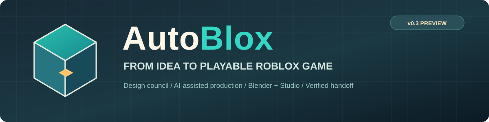
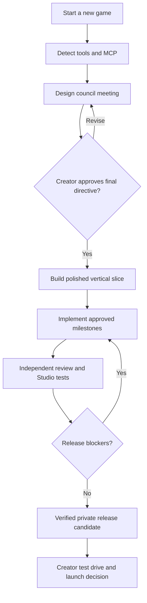

<div align="center">
  

  # AutoBlox

  **A cross-agent, local-first production toolkit for building original Roblox games with AI.**

  [](https://github.com/reallyzip/autoblox/actions/workflows/package-check.yml)
  [](LICENSE)
  [](CHANGELOG.md)
  [](docs/INSTALL.md)

  **One master skill · 41 original Roblox-focused playbooks · Guided design meetings · Blender + Roblox Studio MCP onboarding · Real release gates**

  [**Get started**](#quick-start) · [**Download**](#download) · [**Copy-paste prompts**](#copy-paste-into-your-ai-agent) · [**Setup guide**](docs/INSTALL.md) · [**Contributing**](CONTRIBUTING.md)
</div>

---

## Make a game worth finishing

AutoBlox gives your AI coding assistant a repeatable way to **meet with you about a game concept, challenge and refine the idea, turn decisions into an approved specification, then implement, test and prepare a private Roblox release candidate**. The workflow is inspired by production lessons from a real Roblox development project, but the distributed toolkit does **not** contain that game's source, characters, private place identifiers or assets.

It is built for people making their **first Roblox game** and creators building **multiple different games**. It favors small, enjoyable, complete experiences before expansions; clear project ownership; reusable Blender assets; server-authoritative Luau; and evidence instead of “it should work.”

> **Preview status:** AutoBlox is a development framework, **not a one-click game generator**. Offline tests pass, but real Codex/Claude/Studio/Blender MCP connections and fully autonomous end-to-end game production have **not yet been independently certified**. An AI agent requires its own tool access, permissions, time and successful runtime tests. Public Roblox release always requires the creator's approval.

### What you get

| Capability | What AutoBlox does |
| --- | --- |
| 🧠 **Design council** | Guides a practical idea-to-final-directive meeting; defines audience, core loop, controls, art, scope and acceptance criteria |
| 🏗️ **Production supervisor** | Tracks tasks, prerequisites, agent responsibilities, evidence, recoverable milestones and current project state |
| 🎮 **Roblox engineering** | Routes to Luau, characters, networking, persistence, UI, physics, input, camera and security practices |
| 🎨 **Blender-first assets** | Encourages editable, optimized original models and animations; validates real Studio integration |
| 🤝 **Cross-agent** | Codex, Claude Code, Cursor, Gemini CLI, GitHub Copilot/VS Code; generic skill/MCP fallback |
| 🔌 **First-run setup** | Checks for Roblox Studio and Blender, offers installation and optional MCP connections, and calls for real tool verification |
| ✅ **Evidence-gated release** | Distinguishes source checks, Studio multiplayer tests, device evidence and a saved private build |
| 🔒 **Safe by default** | No silent installs, hooks, publication, purchases, force pushes or credential storage |

## Download

**Recommended:** [Complete AutoBlox Toolkit (ZIP)](https://github.com/reallyzip/autoblox/releases/download/v0.3.0-preview/autoblox-full-toolkit-v0.3.0-preview.zip)

**Existing projects:** [Master Skill Only (ZIP)](https://github.com/reallyzip/autoblox/releases/download/v0.3.0-preview/autoblox-master-skill-v0.3.0-preview.zip)

[Release notes & checksums](https://github.com/reallyzip/autoblox/releases/tag/v0.3.0-preview) · [Browse source code](https://github.com/reallyzip/autoblox) · [All releases](https://github.com/reallyzip/autoblox/releases)

**Available now:** Both ZIPs and the SHA-256 checksum file are published in the [v0.3.0-preview release](https://github.com/reallyzip/autoblox/releases/tag/v0.3.0-preview). This is a preview toolkit: live end-to-end production across all agents is not yet certified.

## Quick start

**Requirements:** Python 3.9+, Git (optional but recommended), and a supported AI coding agent. Roblox Studio is available for **Windows and macOS**; Blender is available for Windows/macOS/Linux. The first-run setup offers missing tools and checks MCP availability; it does not secretly install software.

**1. Clone the toolkit:**

```bash
git clone https://github.com/reallyzip/autoblox.git
cd autoblox
```

Or download and extract the complete toolkit ZIP from [Releases](https://github.com/reallyzip/autoblox/releases/tag/v0.3.0-preview).

**2. Scaffold a fresh Roblox game:**

```bash
python3 scripts/new_game.py \
  --name "My First Roblox Game" \
  --genre "Co-op adventure" \
  --dest ../my-first-roblox-game \
  --git-init
cd ../my-first-roblox-game
```

On Windows PowerShell, use one line and replace `python3` with `py`:

```powershell
py scripts/new_game.py --name "My First Roblox Game" --genre "Co-op adventure" --dest ../my-first-roblox-game --git-init
```

Run the PowerShell example **from the downloaded AutoBlox toolkit directory**, then change into `../my-first-roblox-game`.

**3. Inspect the environment (safe, read-only):**

```bash
python3 scripts/setup_environment.py --project . --agent auto
```

**4. Offer setup only with consent:**

```bash
python3 scripts/setup_environment.py --project . --agent codex --interactive
# or --agent claude / cursor / gemini / vscode / copilot / other
```

For the **actual** MCP connection, enable Studio's built-in server and approve the optional Blender community bridge. Your agent must perform **read-only live calls** to both apps; merely adding config does not prove connectivity. [Full walkthrough](docs/MCP_SETUP.md).

**5. Open your new game's folder in your AI coding tool, then paste:**

```text
Use the roblox-studio-architect skill in this project. First inspect the current
project and check whether Roblox Studio and Blender are installed and connected
to this agent through MCP. Offer safe installation/setup if either is missing;
ask before changes and verify live read-only tool calls. Then run a professional
game design meeting with me, challenge scope, agree on a final game directive,
and wait for my approval before implementation. After approval, create one
polished playable slice first, then develop and independently verify the full
approved game. Keep my Roblox experience PRIVATE until I explicitly authorize
public release; show actual tests, Git checkpoints and remaining blockers.
```

This prompts the **local installed skill**. Pasting it alone into an agent without the toolkit does not install the skill.

## Copy-paste into your AI agent

For a new project created by `new_game.py`, the skill and client instructions are already in the game folder. Choose a launch prompt:

<details open>
<summary><b>OpenAI Codex</b></summary>

```text
Use $roblox-studio-architect in this repository. Run first-use environment and
MCP checks, then guide me through the AutoBlox design council for a new Roblox
game. Once I approve the final directive, coordinate development using the
project's playbooks, Blender, Luau, Rojo, and Roblox Studio. Verify with real
Studio tests before reporting a private release candidate. Do not publish or
spend money without asking.
```

[Codex setup](docs/AGENT_GUIDES.md#codex)
</details>

<details>
<summary><b>Claude Code</b></summary>

```text
Read CLAUDE.md and the roblox-studio-architect skill provided in this project.
Use AutoBlox to check my Roblox Studio and Blender setup, offer safe MCP
onboarding, and verify the actual tools before making in-Studio claims. Lead a
full game concept meeting and obtain my approval of one final directive. Then
implement an original Roblox game with small verified milestones, real tests,
Blender asset provenance and a private release-candidate handoff.
```

[Claude Code setup](docs/AGENT_GUIDES.md#claude-code)
</details>

<details>
<summary><b>Cursor</b></summary>

```text
Read the project .cursor rules, AGENTS.md and the canonical
.agents/skills/roblox-studio-architect/SKILL.md. Follow the AutoBlox design,
implementation and test workflow. First check Roblox Studio and Blender MCP
connections; offer missing setup with my consent, then run a design meeting.
Do not begin full production until I approve the final game directive.
```

[Cursor setup](docs/AGENT_GUIDES.md#cursor)
</details>

<details>
<summary><b>Gemini CLI</b></summary>

```text
Read GEMINI.md, AGENTS.md and the AutoBlox master skill in .agents/skills.
Start with environment and MCP checks, then a professional Roblox game design
meeting. Ask me to approve the complete directive before building. Develop
using verified milestones, real multiplayer tests and private release gates.
```

[Gemini CLI setup](docs/AGENT_GUIDES.md#gemini-cli)
</details>

<details>
<summary><b>GitHub Copilot / VS Code</b></summary>

```text
Use .github/copilot-instructions.md, AGENTS.md, and
.agents/skills/roblox-studio-architect/SKILL.md to follow AutoBlox. Begin by
offering Roblox Studio and Blender setup, verify MCP tool connectivity from
this agent, and run a final-directive design meeting. After approval, develop
and test the game with evidence-gated private release preparation.
```

[Copilot/VS Code setup](docs/AGENT_GUIDES.md#github-copilot-and-vs-code)
</details>

**Using another agent?** Open `AGENTS.md` and the canonical `SKILL.md`; follow [the generic adapter](docs/AGENT_GUIDES.md#other-ai-coding-agents). The skill relies on ordinary files and **does not assume every vendor supports automatic skill discovery or MCP**.

## How AutoBlox works



The master skill loads only the playbooks needed for the task. It does **not** stuff all 41 playbooks into every conversation, reinstall existing plugins, or claim nonexistent subagent/tool capabilities.

## The 41 specialist playbooks

Original task-specific Roblox guidance inspired by the categories in [Awesome Gamedev Agent Skills](https://github.com/gamedev-skills/awesome-gamedev-agent-skills), [Ponytail](https://github.com/DietrichGebert/ponytail), Superpowers, Caveman and established software-engineering practice. **These are independently authored workflows, not copied or bundled upstream skills.** Consult [playbook coverage](.agents/skills/roblox-studio-architect/references/05-skill-coverage.md) and [source acknowledgments](THIRD_PARTY_NOTICES.md).

Examples: Roblox networking and server authority, Luau, persistence, asset generation, Blender integration, avatars/animation, UI, controls, sound, physics, game feel, performance, TDD, root-cause debugging, agent delegation, security review, skill authoring, and concise evidence-led reporting.

## Safety, scope and evidence

- **Private by default.** Public audience changes, monetization and final Roblox launch need explicit user approval.
- **Nothing auto-installs.** The environment wizard offers official installers and optional MCP setup; it requires consent before modifying configuration or running community code.
- **Blender MCP is optional and potentially powerful.** The community bridge may execute Python inside Blender; verify and trust the software before connecting it.
- **No guaranteed autonomous launch.** Real Studio access, correct asset permissions, testing and human acceptance remain necessary.
- **Source-of-truth first.** Preserve existing projects, saved player data, branches, and recoverable Git checkpoints.
- **No affiliation.** AutoBlox is independent, not affiliated with or endorsed by Roblox, OpenAI, Anthropic, Blender or the referenced skill projects.

## Developers and contributors

- [Installation and troubleshooting](docs/INSTALL.md)
- [Agent adapters and copy-paste prompts](docs/AGENT_GUIDES.md)
- [Roblox Studio + Blender MCP setup](docs/MCP_SETUP.md)
- [Architecture and production stages](docs/ARCHITECTURE.md)
- [FAQ](docs/FAQ.md)
- [Roadmap](docs/ROADMAP.md)
- [Launch, creator partnerships and discoverability plan](docs/LAUNCH_AND_DISCOVERY.md)
- [Creator media kit](docs/CREATOR_MEDIA_KIT.md) · [30-day launch calendar](docs/30_DAY_LAUNCH_CALENDAR.md) · [Community showcases](https://github.com/reallyzip/autoblox/issues/new/choose)
- [Contributing](CONTRIBUTING.md) · [Security policy](SECURITY.md) · [Code of Conduct](CODE_OF_CONDUCT.md)

Run offline checks before opening an issue or submitting a pull request:

```bash
python3 -m unittest discover -s scripts/tests -v
python3 scripts/verify_package.py
python3 scripts/build_release.py
```

MIT licensed. See [LICENSE](LICENSE) and [third-party notices](THIRD_PARTY_NOTICES.md). Suggestions, bug reports, and pull requests are welcome. [Open an issue](https://github.com/reallyzip/autoblox/issues/new/choose).
